# Schema PostgreSQL Silansia — Phase 1–7 dan P9-1A

Diagram berikut menggambarkan 19 tabel aplikasi pada schema migration terbaru, termasuk ekspansi P9-1A. Migration P9-1A hanya diterapkan dan diuji pada database terisolasi; database development belum diperluas. Phase 7 hanya menambah constraint/index notifikasi tanpa tabel/kolom baru. Semua PK aplikasi dan FK entitas menggunakan UUID. `NULL` pada komentar berarti relasi/kolom opsional. Tabel infrastruktur Laravel dijelaskan terpisah.

```mermaid
erDiagram
    users {
        uuid id PK
        varchar name
        varchar email UK
        timestamp email_verified_at "NULL"
        varchar password
        varchar remember_token "NULL"
        varchar role "admin, perawat, keluarga"
        boolean is_active
        timestamp created_at "NULL"
        timestamp updated_at "NULL"
    }
    elderlies {
        uuid id PK
        uuid family_id FK
        varchar name
        date birth_date
        boolean is_active
        timestamptz created_at "NULL"
        timestamptz updated_at "NULL"
    }
    service_classes {
        uuid id PK
        varchar code UK "vip, class_2, class_3"
        varchar name
        varchar room_type "private atau shared"
        numeric monthly_price "NULL, harga resmi belum tersedia"
        boolean family_live_cctv
        boolean instant_verified_emergency
        boolean daily_gait_report
        boolean weekly_gait_report
        boolean monthly_gait_report
        boolean verified_incident_summary
        boolean is_active
        timestamptz created_at "NULL"
        timestamptz updated_at "NULL"
    }
    rooms {
        uuid id PK
        uuid service_class_id FK
        varchar code UK
        varchar name
        integer capacity
        boolean is_active
        timestamptz created_at "NULL"
        timestamptz updated_at "NULL"
    }
    elderly_stays {
        uuid id PK
        uuid elderly_id FK
        uuid room_id FK
        timestamptz started_at
        timestamptz ended_at "NULL berarti aktif"
        timestamptz created_at "NULL"
        timestamptz updated_at "NULL"
    }
    service_enrollments {
        uuid id PK
        uuid elderly_id FK
        uuid service_class_id FK
        numeric monthly_price "NULL sampai tarif disepakati"
        timestamptz started_at
        timestamptz ended_at "NULL berarti aktif"
        timestamptz created_at "NULL"
        timestamptz updated_at "NULL"
    }
    cameras {
        uuid id PK
        uuid room_id FK,UK
        varchar name
        varchar source_type "webcam, uploaded_video, rtsp"
        text source_reference "NULL, terenkripsi melalui Eloquent"
        boolean is_active
        timestamptz created_at "NULL"
        timestamptz updated_at "NULL"
    }
    camera_operating_periods {
        uuid id PK
        uuid camera_id FK
        uuid room_id FK
        uuid service_class_id FK
        varchar room_type
        integer room_capacity
        varchar source_type
        timestamptz opened_at "presisi 6"
        timestamptz closed_at "NULL, presisi 6"
        timestamptz created_at "NULL, presisi 6"
        timestamptz updated_at "NULL, presisi 6"
    }
    ai_detections {
        uuid id PK
        uuid camera_id FK
        uuid camera_period_id FK "NULL untuk legacy"
        varchar external_event_id UK
        varchar event_type "gait atau fall"
        timestamptz occurred_at
        timestamptz received_at
        numeric confidence "NULL, probabilitas 0 sampai 1"
        jsonb metadata "NULL, metadata AI opsional"
        timestamptz created_at "NULL"
        timestamptz updated_at "NULL"
    }
    gait_observations {
        uuid id PK
        uuid ai_detection_id FK,UK
        uuid elderly_id FK "NULL untuk identitas tidak diketahui"
        varchar category
        varchar identity_basis "unknown atau vip_room_single_resident"
        timestamptz created_at "NULL"
        timestamptz updated_at "NULL"
    }
    fall_incidents {
        uuid id PK
        uuid ai_detection_id FK,UK
        uuid elderly_id FK "NULL sampai verifikasi"
        varchar status "pending, acknowledged, resolved, false_alarm"
        uuid responding_caregiver_id FK "NULL sebelum respons"
        timestamptz acknowledged_at "NULL sebelum respons"
        uuid verified_by FK "NULL sebelum verifikasi"
        timestamptz verified_at "NULL sebelum verifikasi"
        timestamptz resolved_at "NULL sebelum selesai"
        text notes "NULL, disembunyikan saat serialisasi"
        timestamptz created_at "NULL"
        timestamptz updated_at "NULL"
    }
    fall_incident_actions {
        uuid id PK
        uuid fall_incident_id FK
        uuid actor_id FK
        uuid request_id "UNIQUE bersama actor_id"
        integer sequence "Positif; UNIQUE bersama fall_incident_id"
        varchar action "acknowledge, verify, resolve, false_alarm"
        varchar from_status
        varchar to_status
        uuid elderly_id FK "NULL; hanya pilihan pada verify"
        text notes "NULL untuk acknowledge; privat, wajib pada tindakan lain"
        char request_fingerprint "64 hex; internal"
        timestamptz acted_at "Presisi 6; dibuat server setelah lock"
    }
    notifications {
        uuid id PK
        varchar type
        varchar notifiable_type "App Models User"
        uuid notifiable_id FK
        uuid fall_incident_id FK "NULL jika bukan terkait insiden"
        text data "JSON Laravel, pesan pada data.message"
        timestamptz read_at "NULL berarti belum dibaca"
        timestamptz created_at "NULL"
        timestamptz updated_at "NULL"
    }
    invoices {
        uuid id PK
        varchar number UK
        uuid elderly_id FK
        uuid service_enrollment_id FK
        date billing_month "tanggal pertama setiap bulan"
        numeric amount
        varchar currency "IDR"
        date due_date
        date grace_period_ends_on "due_date ditambah 3 hari kalender"
        varchar status "unpaid, paid, cancelled"
        timestamptz paid_at "NULL jika belum dibayar"
        timestamptz created_at "NULL"
        timestamptz updated_at "NULL"
        smallint billing_schema_version "NULL, tanpa default"
        uuid bill_to_family_id "NULL, tanpa default"
        uuid financial_ownership_period_id "NULL, tanpa default"
        uuid initial_issued_by "NULL, tanpa default"
        timestamptz initial_issued_at "NULL, tanpa default"
        uuid current_revision_id "NULL, tanpa default"
        uuid cancelled_by "NULL, tanpa default"
        timestamptz cancelled_at "NULL, tanpa default"
        text cancellation_reason "NULL, tanpa default"
    }
    payments {
        uuid id PK
        uuid invoice_id FK
        uuid submitted_by FK
        numeric amount
        text proof_path "path penyimpanan privat"
        timestamptz submitted_at
        varchar status "pending, verified, rejected"
        uuid verified_by FK "NULL sebelum tinjauan admin"
        timestamptz verified_at "NULL sebelum tinjauan admin"
        text verification_notes "NULL, privat"
        timestamptz created_at "NULL"
        timestamptz updated_at "NULL"
        smallint billing_schema_version "NULL, tanpa default"
        uuid invoice_revision_id "NULL, tanpa default"
        varchar submission_channel "NULL, tanpa default"
        char proof_sha256 "NULL, tanpa default"
        bigint proof_size_bytes "NULL, tanpa default"
        varchar proof_mime "NULL, tanpa default"
        varchar proof_disk "NULL, tanpa default"
        text public_rejection_reason "NULL, tanpa default"
    }

    financial_ownership_periods {
        uuid id PK
        uuid elderly_id
        uuid family_id
        uuid previous_period_id "NULL"
        timestamptz effective_from
        timestamptz effective_to "NULL"
        uuid recorded_by
        timestamptz recorded_at
        varchar source
    }
    invoice_revisions {
        uuid id PK
        uuid invoice_id
        uuid elderly_id
        uuid service_enrollment_id
        integer revision_no
        uuid previous_revision_id "NULL"
        uuid issued_by
        timestamptz issued_at
        varchar policy_version
        numeric monthly_price
        timestamptz effective_started_at
        timestamptz effective_ended_at
        smallint chargeable_days
        smallint days_in_month
        numeric amount
        varchar currency
        date due_date
        date grace_period_ends_on
        varchar reason_code
        text reason "NULL"
        char content_hash
    }
    billing_requests {
        uuid id PK
        uuid actor_id
        uuid request_id
        varchar operation
        char intent_hash
        uuid invoice_id
        uuid outcome_payment_id "NULL"
        uuid outcome_revision_id "NULL"
        timestamptz completed_at
    }
    billing_actions {
        uuid id PK
        uuid billing_request_id "NULL"
        uuid actor_id
        uuid invoice_id "NULL"
        uuid ownership_period_id "NULL"
        uuid payment_id "NULL"
        uuid revision_id "NULL"
        bigint invoice_sequence "NULL"
        varchar action
        timestamptz occurred_at
        varchar reason_code "NULL"
        text private_note "NULL"
        jsonb details
    }

    users ||--o{ elderlies : family_id
    service_classes ||--o{ rooms : service_class_id
    elderlies ||--o{ elderly_stays : elderly_id
    rooms ||--o{ elderly_stays : room_id
    elderlies ||--o{ service_enrollments : elderly_id
    service_classes ||--o{ service_enrollments : service_class_id
    rooms ||--o| cameras : room_id
    cameras ||--o{ ai_detections : camera_id
    cameras ||--o{ camera_operating_periods : camera_id
    rooms ||--o{ camera_operating_periods : room_id
    service_classes ||--o{ camera_operating_periods : service_class_id
    camera_operating_periods o|--o{ ai_detections : camera_period_id
    ai_detections ||--o| gait_observations : ai_detection_id
    elderlies o|--o{ gait_observations : elderly_id
    ai_detections ||--o| fall_incidents : ai_detection_id
    elderlies o|--o{ fall_incidents : elderly_id
    users o|--o{ fall_incidents : responding_caregiver_id
    users o|--o{ fall_incidents : verified_by
    fall_incidents ||--o{ fall_incident_actions : fall_incident_id
    users ||--o{ fall_incident_actions : actor_id
    elderlies o|--o{ fall_incident_actions : elderly_id
    users ||--o{ notifications : notifiable_id
    fall_incidents o|--o{ notifications : fall_incident_id
    elderlies ||--o{ invoices : elderly_id
    service_enrollments ||--o{ invoices : service_enrollment_id
    invoices ||--o{ payments : invoice_id
    users ||--o{ payments : submitted_by
    users o|--o{ payments : verified_by
    elderlies ||--o{ financial_ownership_periods : elderly_id
    users ||--o{ financial_ownership_periods : family_id
    users ||--o{ financial_ownership_periods : recorded_by
    financial_ownership_periods o|--o| financial_ownership_periods : previous_period_id
    financial_ownership_periods o|--o{ invoices : ownership_context
    users o|--o{ invoices : bill_to_family_id
    users o|--o{ invoices : initial_issued_by
    users o|--o{ invoices : cancelled_by
    invoices ||--o{ invoice_revisions : invoice_context
    users ||--o{ invoice_revisions : issued_by
    invoice_revisions o|--o{ invoice_revisions : previous_revision_id
    invoice_revisions o|--o| invoices : current_revision_deferred
    invoice_revisions o|--o{ payments : invoice_revision_context
    invoices ||--o{ billing_requests : invoice_id
    users ||--o{ billing_requests : actor_id
    payments o|--o{ billing_requests : outcome_payment
    invoice_revisions o|--o{ billing_requests : outcome_revision
    billing_requests o|--o{ billing_actions : request_invoice_actor
    users ||--o{ billing_actions : actor_id
    invoices o|--o{ billing_actions : invoice_id
    financial_ownership_periods o|--o{ billing_actions : ownership_period_id
    payments o|--o{ billing_actions : payment_context
    invoice_revisions o|--o{ billing_actions : revision_context
```

Phase 4B menambahkan periode operasi kamera dengan snapshot kamar/kelas/kapasitas/source_type tanpa credential. Aktivasi/deactivation membuka/menutup periode melalui layanan dalam transaksi yang sama. FK gabungan `(camera_period_id, camera_id)` pada deteksi memastikan periode milik kamera tersebut; nullable hanya untuk kompatibilitas legacy. `occurred_at`/`received_at` deteksi serta timestamps periode memakai presisi 6; timestamp domain lama lainnya tetap presisi 0. Lookup kamar historis harus melalui periode, bukan `camera.room` sekarang. Tidak ada backfill historis atau aktivasi kamera otomatis.

## Constraint yang diterapkan

- PK UUID dihasilkan oleh `HasUuids`; tidak ada default UUID SQL. Penulisan SQL langsung wajib menyediakan UUID.
- `users.role` terbatas ke tiga peran. Akun baru default `keluarga` dan tidak aktif. Peran/aktivasi tidak dapat diisi melalui mass assignment `User`.
- FK riwayat menggunakan `ON DELETE RESTRICT`. Satu pengecualian infrastruktur adalah `sessions.user_id` menggunakan `ON DELETE SET NULL`.
- `elderly_stays_one_active` dan `service_enrollments_one_active` merupakan partial unique index pada `elderly_id WHERE ended_at IS NULL`. Riwayat yang berakhir tetap disimpan; `ended_at` harus lebih besar daripada `started_at`.
- `rooms.capacity > 0`. Pemeriksaan okupansi dan aturan kapasitas VIP memerlukan transaksi aplikasi, lihat batasan di bawah.
- `cameras.room_id`, `ai_detections.external_event_id`, dan masing-masing `ai_detection_id` di gait/insiden unik. ID event diasumsikan unik global di seluruh kamera/produsen.
- Kode kelas dan tipe kamar dibatasi: VIP/private, kelas 2–3/shared. Harga kelas/enrollment nullable dan tidak negatif bila diisi. Nilai uang invoice/payment tidak negatif, disimpan sebagai `numeric(14,2)`, bukan float.
- Migration aditif `2026_10_21_000003_reject_nan_monetary_values.php` menolak nilai khusus numeric NaN pada empat kolom uang melalui CHECK `*_not_nan`. Preflight dalam transaksi memeriksa data sebelum ADD CHECK dan membatalkan proses tanpa koreksi otomatis jika ditemukan NaN. Constraint nonnegatif/nullability lama tetap berlaku.
- Confidence AI opsional `numeric(6,5)`, rentang 0–1; bukan metrik klinis. `metadata` AI dan `billing_actions.details` menggunakan JSONB. `notifications.data` berupa teks JSON agar mengikuti Laravel.
- Gait hanya menerima tiga kategori sementara. Identitas NULL memakai `identity_basis=unknown`; identitas terisi harus memakai `vip_room_single_resident`.
- Insiden pending tanpa identitas/responder/verifikasi. Status selain pending memerlukan responder dan acknowledgement. Status resolved memerlukan verifikasi dan waktu selesai; identitas tetap boleh NULL bila penghuni tidak bisa dipastikan. False alarm ditutup tanpa identitas/verifikasi kejadian jatuh. Waktu verifikasi/penutupan tidak boleh mendahului acknowledgement.
- Notifikasi memakai satu tabel native dengan UUID morph recipient, dibatasi ke kelas `App\Models\User` dan FK users. Pesan berada di `data.message`; pengiriman staf Phase 7 dijelaskan di bawah, sedangkan notifikasi keluarga/gait tetap ditunda.
- FK gabungan `(service_enrollment_id, elderly_id)` menjamin invoice tidak merujuk enrollment milik lansia lain. Unik `(elderly_id, billing_month)` membatasi satu invoice per lansia per bulan. Perubahan kelas/prorata intra-bulan belum dirancang sebagai beberapa invoice.
- `grace_period_ends_on = due_date + 3` menggunakan aritmetika DATE PostgreSQL, termasuk pergantian bulan/tahun. Evaluasi jatuh tempo nantinya menggunakan tanggal operasional Asia/Jakarta.
- Invoice `paid` wajib memiliki `paid_at`; pembayaran yang telah ditinjau (verified/rejected) wajib memiliki peninjau dan waktu tinjauan. Pemeriksaan kewenangan admin dan perubahan status invoice belum diimplementasikan.
- Indeks FK dan waktu mendukung pencarian keluarga, kamar, histori, event per kamera/jenis, antrean insiden, notifikasi belum dibaca, dan tagihan jatuh tempo. PostgreSQL otomatis membuat indeks PK/UNIQUE, tetapi tidak untuk setiap FK; migration menambahkan indeks FK yang diperlukan.

## Aturan lintas baris yang belum ditegakkan database

Phase 1 tidak menyediakan layanan mutasi operasional. Pada tahap layanan transaksi, wajib menegakkan:

1. `family_id` adalah pengguna aktif berperan keluarga; responder/verifikator insiden adalah perawat yang berwenang; verifikator pembayaran adalah admin.
2. Kamar VIP berkapasitas 1, jumlah penghuni aktif tidak melebihi kapasitas, dan kelas kamar sama dengan enrollment aktif. Gunakan transaksi dan `SELECT ... FOR UPDATE` pada kamar serta lansia; lock kamar lama/baru dalam urutan UUID yang konsisten. Periksa ulang setelah lock sebelum menulis stay/enrollment. Perubahan kapasitas/kelas harus memakai protokol lock yang sama.
3. Periode riwayat tidak tumpang tindih, tidak dimulai di masa depan sebagai penempatan aktif, dan sesuai periode enrollment. Partial index menjamin maksimal satu record terbuka, bukan semua overlap historis.
4. Gait harus berasal dari event `gait`, insiden dari event `fall`. Database belum melarang satu event dipakai di kedua tabel. Layanan ingestion wajib memeriksa discriminator dan idempotensi dalam transaksi.
5. Asosiasi gait VIP hanya berdasarkan satu penghuni aktif pada **waktu event** dan konfigurasi kamera yang benar. Gait kamar bersama tetap NULL bila identitas tidak diketahui. Tidak ada biometrik atau pengenalan wajah.
6. Camera yang sudah memiliki event tidak boleh dipindah kamar, agar histori room-level tidak berubah. Demikian pula pemilik keluarga dan kelas enrollment bersejarah perlu kebijakan perubahan eksplisit.
7. Verifikasi keluarga penerima notifikasi dan entitlement per lansia; status terverifikasi saja tidak berarti notifikasi telah dikirim. Validasi payload JSON/pesan dilakukan tahap berikut.
8. Harga enrollment merupakan snapshot tarif yang disepakati; invoice mengacu enrollment yang berlaku pada periode billing. Pembayaran terverifikasi harus sesuai jumlah tagihan; rekonsiliasi/prorata belum dibuat.

Aturan tersebut adalah pekerjaan tahap berikut, bukan jaminan dari constraint Phase 1. Tidak ada trigger tersembunyi yang menegakkannya.

Perkembangan Phase 3C: sesuai keputusan pengguna, pengaman masa tinggal/enrollment diimplementasikan pada layanan transaksi tanpa perubahan schema. Enrollment mendahului stay, boleh tetap aktif tanpa stay, dan tidak boleh ditutup selama stay masih aktif. Kelas harus cocok dengan kamar, harga NULL ditolak saat pembuatan enrollment, dan snapshot tidak dihitung ulang. Urutan lock aplikasi adalah actor → kelas berurutan UUID → kamar → lansia → record operasional, dengan PostgreSQL READ COMMITTED. Penulisan waktu memakai waktu server; workflow tidak menerima backdate atau penjadwalan. Partial unique indexes melindungi maksimal satu record terbuka; seluruh aturan lintas tabel tersebut tetap bukan jaminan untuk SQL langsung yang melewati layanan.

Perkembangan Phase 4B: gateway memakai urutan kelas → kamar → calon lansia → kamera → periode → deteksi/child. UNIQUE event global dipertahankan dengan namespace sumber/UUID produsen dan hash payload canonical. Deteksi dan child disimpan atomik, tipe event diperiksa layanan; insiden selalu pending tanpa verifikasi/identitas/notifikasi otomatis. Gait shared tetap unknown; VIP memakai satu stay/enrollment historis yang cocok. Partial UNIQUE satu periode terbuka, CHECK interval/snapshot, dan FK RESTRICT melengkapi layanan; tidak ada trigger aplikasi untuk seluruh overlap lintas baris. Kontrak web berversi dan batas late event 24 jam ada pada [spesifikasi API](../api/SILANSIA_AI_GATEWAY_V1.md); layanan model nyata belum diintegrasikan.

## Notifikasi staf Phase 7

Jenis `silansia.fall_pending.v1` memakai payload statis berversi dan FK insiden top-level. CHECK `notifications_staff_incident_check` mewajibkan FK insiden untuk jenis ini; partial UNIQUE `notifications_staff_incident_unique` membatasi satu row per morph/recipient/type/insiden. Jenis legacy tidak diberi deduplikasi baru dan FK tetap nullable pada kolom. Semua sembilan kolom dipertahankan. Pengiriman notifikasi staf telah dibuat pada Phase 7; keluarga/gait tetap ditunda.

Fan-out pending hanya untuk Admin/Perawat aktif, terpisah dari transaksi sumber dan tanpa syarat billing/kelas. Lock recipient UUID mendahului insiden; UNIQUE terarah menjaga retry. Job sesudah outer commit dan rekonsiliasi terjadwal memulihkan pending yang belum terkirim. Tidak ada backfill, outbox, cohort ledger, atau perubahan kontrak AI v1. Inbox scoped milik akun dan mark read hanya mengisi read_at; status insiden/jurnal tetap melalui Phase 6. Payload privat tidak diteruskan sebagai props. Lihat [panduan database](README.md) dan [laporan Phase 7](../report/SILANSIA_PHASE_7_REPORT.md).

## Infrastruktur dan migrasi legacy

`password_reset_tokens`, `sessions`, `cache`, `cache_locks`, `jobs`, `job_batches`, `failed_jobs`, dan `migrations` dipertahankan. PK sesi tetap string yang dihasilkan Laravel; hanya `sessions.user_id` menjadi UUID. Kolom timestamp users lama tetap timestamp tanpa timezone; semua tabel domain baru menggunakan timestamp dengan timezone.

Migration konversi memperoleh lock eksklusif dan menolak `users` yang terisi atau sesi dengan `user_id` terisi. Tidak ada data yang dibuang/dipetakan otomatis. Migration awal yang sudah diterapkan tidak diubah. Rollback konversi juga menolak data UUID terisi; rollback lengkap hanya diuji pada DB terisolasi yang kosong setelah transaksi tes dibatalkan.

Rujukan API migration: [dokumentasi resmi Laravel 13](https://laravel.com/framework/docs/13.x/migrations). Detail native notification dan `HasUuids` juga diperiksa pada source dependency lokal Laravel 13.33.0.

## Batas ekspansi P9-1A

Empat entitas billing di diagram adalah struktur migration baru yang diuji pada database terisolasi. Kolom nullable pada invoice/payment tidak diisi otomatis. Target composite FK menggunakan UNIQUE immediate; pointer current revision NO ACTION deferred memungkinkan root dan R1 dalam satu transaksi. Predikat root/open ownership dan pending/verified payment memakai partial UNIQUE. Schema hanya PARTIALLY ENFORCED: belum ada immutable/append-only trigger, managed-writer gate, guard chain/prorata/payment final, atau ownership capture. Detail lokal, rollback guard dan batas keamanan ada pada [panduan database](README.md#ekspansi-schema-billing-p9-1a). Billing belum dapat digunakan dan migration ini belum diterapkan pada manpro_db.

## Enforcement tambahan P9-1B

P9-1B mempertahankan seluruh 19 entitas/260 kolom target diagram dan menambahkan function/trigger serta satu query index, tanpa perubahan field atau FK. Untuk managed v1, immediate guards membatasi mutasi/history, dan deferred validators memeriksa graph revision/header/payment/request/action serta ledger pada akhir transaksi. Penjelasan P9-1A di atas merupakan batas tahap ekspansi sebelum guard. Mandatory resident ownership capture, INSERT-v1 gate dan writer invoice/payment tetap tidak aktif; source elderlies/users/enrollment tidak diberi trigger baru. Integrasi writer create/transfer P9-1C dijelaskan di bawah dan tetap default OFF; pemakaian ledger untuk billing masih memerlukan aktivasi/cutover terpisah. Tidak ada schema billing P9-1A/P9-1B pada development. Lihat [klasifikasi dan lock/error contract](README.md#integrity-guards-p9-1b) dan laporan P9-1B untuk hasil eksekusi aktual, bukan menyimpulkan semua aturan domain telah enforced hanya dari ERD.

## Integrasi writer P9-1C

Tidak ada perubahan struktur diagram atau migration baru. ResidentService dan FinancialOwnershipLedgerService menyiapkan create/root resident_create serta transfer/successor family_transfer yang atomik dengan ownership actions. Gate konfigurasi eksplisit default OFF mempertahankan kompatibilitas schema development lama; tidak ada capture otomatis setelah migration. Saat ON, readiness A/B diverifikasi, waktu database diambil setelah lock dan legacy resident tanpa ledger ditolak sampai cutover terpisah. Ledger-aware writer yang disiapkan tidak berarti billing/entitlement atau mandatory guard terhadap arbitrary SQL telah aktif. Detail [lifecycle, gate dan cutover](README.md#writer-ownership-ledger-p9-1c--gate-default-off); hasil tes dan preservasi pada laporan P9-1C.
