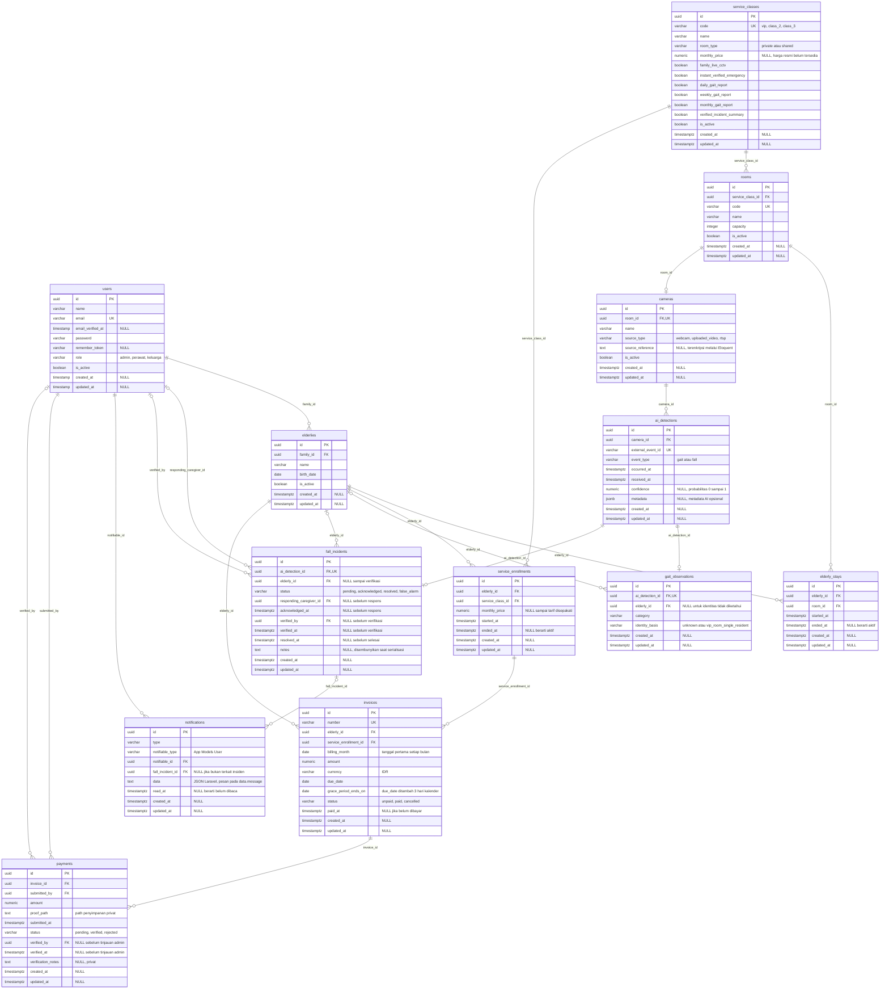

# ERD fondasi database Silansia — Phase 1

Diagram berikut menggambarkan 13 tabel aplikasi yang diimplementasikan. Semua PK aplikasi dan FK entitas menggunakan UUID. `NULL` pada komentar berarti relasi/kolom opsional. Tabel infrastruktur Laravel dijelaskan terpisah.

## Constraint yang diterapkan

- PK UUID dihasilkan oleh `HasUuids`; tidak ada default UUID SQL. Penulisan SQL langsung wajib menyediakan UUID.
- `users.role` terbatas ke tiga peran. Akun baru default `keluarga` dan tidak aktif. Peran/aktivasi tidak dapat diisi melalui mass assignment `User`.
- FK riwayat menggunakan `ON DELETE RESTRICT`. Satu pengecualian infrastruktur adalah `sessions.user_id` menggunakan `ON DELETE SET NULL`.
- `elderly_stays_one_active` dan `service_enrollments_one_active` merupakan partial unique index pada `elderly_id WHERE ended_at IS NULL`. Riwayat yang berakhir tetap disimpan; `ended_at` harus lebih besar daripada `started_at`.
- `rooms.capacity > 0`. Pemeriksaan okupansi dan aturan kapasitas VIP memerlukan transaksi aplikasi, lihat batasan di bawah.
- `cameras.room_id`, `ai_detections.external_event_id`, dan masing-masing `ai_detection_id` di gait/insiden unik. ID event diasumsikan unik global di seluruh kamera/produsen.
- Kode kelas dan tipe kamar dibatasi: VIP/private, kelas 2–3/shared. Harga kelas/enrollment nullable dan tidak negatif bila diisi. Nilai uang invoice/payment tidak negatif, disimpan sebagai `numeric(14,2)`, bukan float.
- Migration aditif `2026_10_21_000003_reject_nan_monetary_values.php` menolak nilai khusus numeric NaN pada empat kolom uang melalui CHECK `*_not_nan`. Preflight dalam transaksi memeriksa data sebelum ADD CHECK dan membatalkan proses tanpa koreksi otomatis jika ditemukan NaN. Constraint nonnegatif/nullability lama tetap berlaku.
- Confidence AI opsional `numeric(6,5)`, rentang 0–1; bukan metrik klinis. `metadata` AI merupakan satu-satunya kolom JSONB. `notifications.data` berupa teks JSON agar mengikuti Laravel.
- Gait hanya menerima tiga kategori sementara. Identitas NULL memakai `identity_basis=unknown`; identitas terisi harus memakai `vip_room_single_resident`.
- Insiden pending tanpa identitas/responder/verifikasi. Status selain pending memerlukan responder dan acknowledgement. Status resolved memerlukan verifikasi dan waktu selesai; identitas tetap boleh NULL bila penghuni tidak bisa dipastikan. False alarm ditutup tanpa identitas/verifikasi kejadian jatuh. Waktu verifikasi/penutupan tidak boleh mendahului acknowledgement.
- Notifikasi memakai satu tabel native dengan UUID morph recipient, dibatasi ke kelas `App\Models\User` dan FK users. Pesan berada di `data.message`; payload lain mengikuti kebutuhan tahap berikut. Pengiriman belum dibuat.
- FK gabungan `(service_enrollment_id, elderly_id)` menjamin invoice tidak merujuk enrollment milik lansia lain. Unik `(elderly_id, billing_month)` membatasi satu invoice per lansia per bulan. Perubahan kelas/prorata intra-bulan belum dirancang sebagai beberapa invoice.
- `grace_period_ends_on = due_date + 3` menggunakan aritmetika DATE PostgreSQL, termasuk pergantian bulan/tahun. Evaluasi jatuh tempo nantinya menggunakan tanggal operasional Asia/Jakarta.
- Invoice `paid` wajib memiliki `paid_at`; pembayaran yang telah ditinjau (verified/rejected) wajib memiliki peninjau dan waktu tinjauan. Pemeriksaan kewenangan admin dan perubahan status invoice belum diimplementasikan.
- Indeks FK dan waktu mendukung pencarian keluarga, kamar, histori, event per kamera/jenis, antrean insiden, notifikasi belum dibaca, dan tagihan jatuh tempo. PostgreSQL otomatis membuat indeks PK/UNIQUE, tetapi tidak untuk setiap FK; migration menambahkan indeks FK yang diperlukan.

## Aturan lintas baris yang belum ditegakkan database

Phase 1 tidak menyediakan layanan mutasi operasional. Pada tahap layanan transaksi, wajib menegakkan:

1. `family_id` adalah pengguna aktif berperan keluarga; responder/verifikator insiden adalah perawat yang berwenang; verifikator pembayaran adalah admin.
2. Kamar VIP berkapasitas 1, jumlah penghuni aktif tidak melebihi kapasitas, dan kelas kamar sama dengan enrollment aktif. Gunakan transaksi dan `SELECT ... FOR UPDATE` pada kamar serta lansia; lock kamar lama/baru dalam urutan UUID yang konsisten. Periksa ulang setelah lock sebelum menulis stay/enrollment. Perubahan kapasitas/kelas harus memakai protokol lock yang sama.
3. Periode riwayat tidak tumpang tindih, tidak dimulai di masa depan sebagai penempatan aktif, dan sesuai periode enrollment. Partial index menjamin maksimal satu record terbuka, bukan semua overlap historis.
4. Gait harus berasal dari event `gait`, insiden dari event `fall`. Database belum melarang satu event dipakai di kedua tabel. Layanan ingestion wajib memeriksa discriminator dan idempotensi dalam transaksi.
5. Asosiasi gait VIP hanya berdasarkan satu penghuni aktif pada **waktu event** dan konfigurasi kamera yang benar. Gait kamar bersama tetap NULL bila identitas tidak diketahui. Tidak ada biometrik atau pengenalan wajah.
6. Camera yang sudah memiliki event tidak boleh dipindah kamar, agar histori room-level tidak berubah. Demikian pula pemilik keluarga dan kelas enrollment bersejarah perlu kebijakan perubahan eksplisit.
7. Verifikasi keluarga penerima notifikasi dan entitlement per lansia; status terverifikasi saja tidak berarti notifikasi telah dikirim. Validasi payload JSON/pesan dilakukan tahap berikut.
8. Harga enrollment merupakan snapshot tarif yang disepakati; invoice mengacu enrollment yang berlaku pada periode billing. Pembayaran terverifikasi harus sesuai jumlah tagihan; rekonsiliasi/prorata belum dibuat.

Aturan tersebut adalah pekerjaan tahap berikut, bukan jaminan dari constraint Phase 1. Tidak ada trigger tersembunyi yang menegakkannya.

## Infrastruktur dan migrasi legacy

`password_reset_tokens`, `sessions`, `cache`, `cache_locks`, `jobs`, `job_batches`, `failed_jobs`, dan `migrations` dipertahankan. PK sesi tetap string yang dihasilkan Laravel; hanya `sessions.user_id` menjadi UUID. Kolom timestamp users lama tetap timestamp tanpa timezone; semua tabel domain baru menggunakan timestamp dengan timezone.

Migration konversi memperoleh lock eksklusif dan menolak `users` yang terisi atau sesi dengan `user_id` terisi. Tidak ada data yang dibuang/dipetakan otomatis. Migration awal yang sudah diterapkan tidak diubah. Rollback konversi juga menolak data UUID terisi; rollback lengkap hanya diuji pada DB terisolasi yang kosong setelah transaksi tes dibatalkan.

Rujukan API migration: [dokumentasi resmi Laravel 13](https://laravel.com/framework/docs/13.x/migrations). Detail native notification dan `HasUuids` juga diperiksa pada source dependency lokal Laravel 13.33.0.
